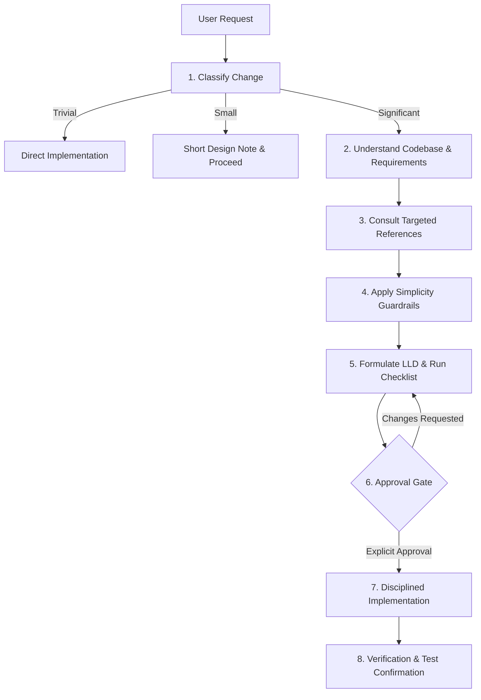

# LLD-First Engineering Skill (`lld-first-engineering`)

> **Design-before-code workflow for AI coding assistants and software engineers.**  
> Produces a reviewed, battle-tested Low-Level Design (LLD) and requires explicit human approval before writing or modifying implementation code.

---

## 📖 Overview

AI coding agents excel at generating syntax, but left unconstrained, they often jump straight into writing code—hallucinating abstractions, introducing unnecessary design patterns, or bypassing existing architectural conventions.

**LLD-First Engineering** is an agent skill that enforces disciplined, low-level design before implementation. It ensures that every significant change is understood, designed to fit the existing codebase, rigorously checked against simplicity guardrails, and explicitly approved by the user before a single line of production code is written.

### Core Philosophy
* **Mistakes are cheap on paper, expensive in code.** Pivoting a 15-line design note takes seconds; refactoring a broken 500-line multi-module implementation wastes hours.
* **Simplicity is king.** The default answer is *no pattern*, *no extra interface*, and *no speculative generalization*.
* **Codebase conventions rule.** Patterns and abstractions must match the host project's idioms, frameworks, and dependency injection style.
* **No silent implementation.** Explicit human approval is required prior to code generation.

---

## 🚦 Change Classification

Not every change requires a full design document. The skill classifies tasks into three tiers:

| Tier | Change Type | Action Required |
|---|---|---|
| 🟢 **Trivial** | Typos, config values, one-line bugfixes, simple renames | Implement directly. No LLD needed. |
| 🟡 **Small** | Single function/class changes, no new abstractions or dependencies | 3–6 line design note (what changes, where, testing). Proceed unless user objects. |
| 🔴 **Significant** | New modules/services, new interfaces, cross-module impacts, public APIs, database schemas, concurrency | **Full LLD workflow** + review checklist + **mandatory approval gate**. |

*Rule of thumb: When unsure, treat the change as Significant.*

---

## 🔄 The 8-Step Workflow



1. **Classify the change**: Identify if the task is Trivial, Small, or Significant.
2. **Understand before designing**: Inspect existing code, idioms, error handling, DI, and test patterns. Clarify ambiguous requirements before writing design specs.
3. **Consult references**: Pull only the specific guidance needed (SOLID, design principles, or pattern selection guides).
4. **Resolve conflicts by precedence**:
   $$\text{User Requirements} > \text{Codebase Conventions} > \text{Simplicity (YAGNI)} > \text{SOLID} > \text{Design Patterns}$$
5. **Enforce simplicity guardrails**:
   - No single-implementation interfaces unless at I/O, external boundaries, or test seams.
   - Rule of Three: Abstract on the third repetition, not the first.
   - Concrete justification: Every new class, layer, or pattern must articulate the real problem it solves.
6. **Produce standardized LLD specification**: Follow the unified markdown schema.
7. **Approval gate**: Halt and wait for user sign-off (`"approved"`, `"go ahead"`). Silence or tangential replies are **not** approval.
8. **Implement & verify**: Implement strictly to the approved design. If unexpected edge cases arise, stop and explain the delta rather than silently deviating.

---

## 📋 Standard LLD Output Specification

When generating a Low-Level Design for significant changes, the skill outputs a structured document:

```markdown
## LLD: <Feature or Component Name>

### Summary
2–3 sentence overview of what is being built or changed.

### Requirements
- **Functional**: Capabilities and user interactions.
- **Non-Functional**: Latency, throughput, security, memory limits.
- **Out of Scope**: Explicit boundaries of what will NOT be done.

### Components
Each proposed class, service, or module with its Single Responsibility.

### Interfaces
Signatures, contracts, and type definitions adhering to the host language and codebase idioms.

### Data Flow
Step-by-step sequence of operations (optionally accompanied by a Mermaid sequence diagram).

### Error Handling
Catalog of potential failure modes and recovery/fallback mechanisms.

### Testing Strategy
Unit, integration, and edge-case testing plans, detailing what is mocked vs. exercised live.

### Justifications
Concrete rationale for every interface, layer, or pattern introduced.

### Alternatives Considered
Simpler approaches considered and why they were insufficient.

### Risks & Open Questions
Known trade-offs, tech debt created, or questions needing user resolution.
```

---

## 📚 Reference Library

The skill includes deep, pragmatic reference guides designed for quick lookup without overengineering:

| Reference Document | Key Focus |
|---|---|
| [`references/lld-review-checklist.md`](skills/lld-first-engineering/references/lld-review-checklist.md) | Pre-flight 12-section validation checklist to run before presenting any LLD. |
| [`references/solid-principles.md`](skills/lld-first-engineering/references/solid-principles.md) | Single Responsibility, Open/Closed, Liskov Substitution, Interface Segregation, Dependency Inversion applied pragmatically. |
| [`references/general-design-principles.md`](skills/lld-first-engineering/references/general-design-principles.md) | KISS, YAGNI, DRY, Encapsulation, Law of Demeter, and Composition over Inheritance. |
| [`references/pattern-selection-guide.md`](skills/lld-first-engineering/references/pattern-selection-guide.md) | 6-step framework to determine if a design pattern is justified or an over-engineered anti-pattern. |
| [`references/creational-patterns.md`](skills/lld-first-engineering/references/creational-patterns.md) | Factory Method, Abstract Factory, Builder, Prototype, Singleton (with safe DI alternatives). |
| [`references/structural-patterns.md`](skills/lld-first-engineering/references/structural-patterns.md) | Adapter, Bridge, Composite, Decorator, Facade, Flyweight, Proxy. |
| [`references/behavioral-patterns.md`](skills/lld-first-engineering/references/behavioral-patterns.md) | Strategy, State, Observer, Command, Chain of Responsibility, Template Method, Mediator, Memento, Iterator, Visitor. |

---

## 🚀 Installation & Quickstart

### Option A: Install via `npx` (Fastest & Recommended)

Run this one-liner in any workspace:

```bash
npx lld-first-engineering
```

The interactive installer will ask where you'd like to install:
- **Antigravity (Workspace)**: `.gemini/antigravity/skills/lld-first-engineering`
- **Antigravity (Global)**: `~/.gemini/antigravity/skills/lld-first-engineering`
- **Cursor**: Sets up `.cursor/rules/lld-first-engineering.mdc` and references
- **Claude Code**: Sets up `.claude/skills/lld-first-engineering`
- **Generic / Standalone**: Copies to `./skills/lld-first-engineering`

#### Non-Interactive / CI Flags:
```bash
# Install to current Antigravity workspace automatically
npx lld-first-engineering --target antigravity -y

# Install globally for all projects
npx lld-first-engineering --target antigravity-global -y

# Install Cursor rule and skill references
npx lld-first-engineering --target cursor -y

# Install to custom path
npx lld-first-engineering --dest ./custom/path
```

---

### Option B: Manual Installation

#### 1. In Antigravity / Agentic Environments
Copy this skill into your skills directory:

```bash
# Workspace-level skill (active in this project)
mkdir -p .gemini/antigravity/skills
cp -r skills/lld-first-engineering .gemini/antigravity/skills/

# Or Global user skill (available across all projects)
mkdir -p ~/.gemini/antigravity/skills
cp -r skills/lld-first-engineering ~/.gemini/antigravity/skills/
```

#### 2. In Cursor / Claude Code / Windsurf / Copilot
Add the skill's instructions to your agent rules file (e.g., `.cursorrules`, `CLAUDE.md`, or `.windsurfrules`):
- Point the agent to `skills/lld-first-engineering/SKILL.md` as mandatory instructions for feature design and refactoring.
- Link the `references/` directory as supporting context.

### Triggering the Skill
The skill automatically activates whenever you request:
- Adding a new service, class, module, or schema
- Refactoring existing code or restructuring packages
- Modifying public APIs or contracts
- Asking *"How should I design/structure this?"*

You can also explicitly trigger it:
> *"Use lld-first-engineering to design a resilient retry-and-circuit-breaker mechanism for our payment gateway integration."*

---

## 📁 Repository Layout

```text
.
├── README.md                                       # Repository and skill documentation
├── CONTRIBUTING.md                                 # Guidelines for contributing
├── LICENSE                                         # MIT License
├── package.json                                    # npm package config and bin entry
├── bin/
│   └── cli.js                                      # Zero-dependency npx installer
└── skills/
    └── lld-first-engineering/
        ├── SKILL.md                                # Core skill definition and workflow rules
        └── references/
            ├── behavioral-patterns.md              # Behavioral patterns catalog & decision trees
            ├── creational-patterns.md              # Creational patterns catalog & decision trees
            ├── general-design-principles.md        # Core engineering design principles
            ├── lld-review-checklist.md             # Pre-submission review checklist
            ├── pattern-selection-guide.md          # Pattern justification criteria
            ├── solid-principles.md                 # Pragmatic SOLID application
            └── structural-patterns.md              # Structural patterns catalog & decision trees
```

---

## 🤝 Contributing

Contributions, pattern expansions, and language idiomatic examples are welcome! Please check out [CONTRIBUTING.md](CONTRIBUTING.md) to get started.

## 📄 License

This project is open-source under the [MIT License](LICENSE).
